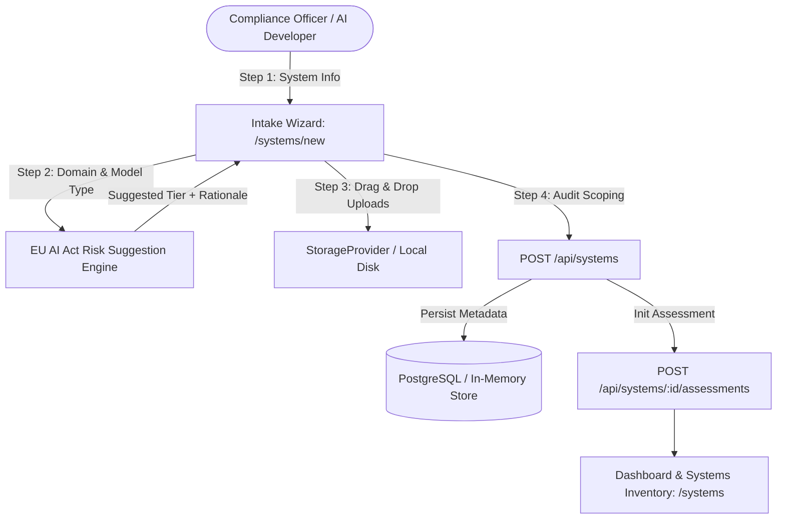
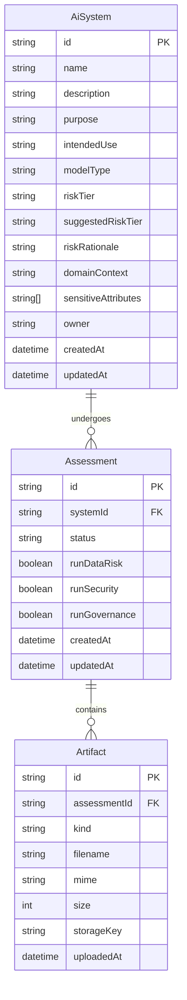
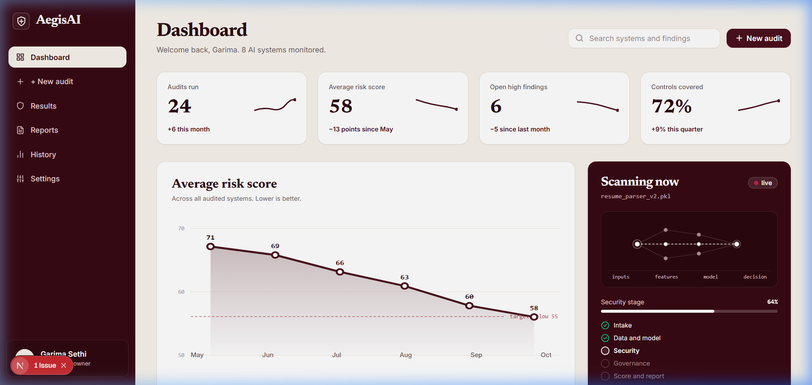
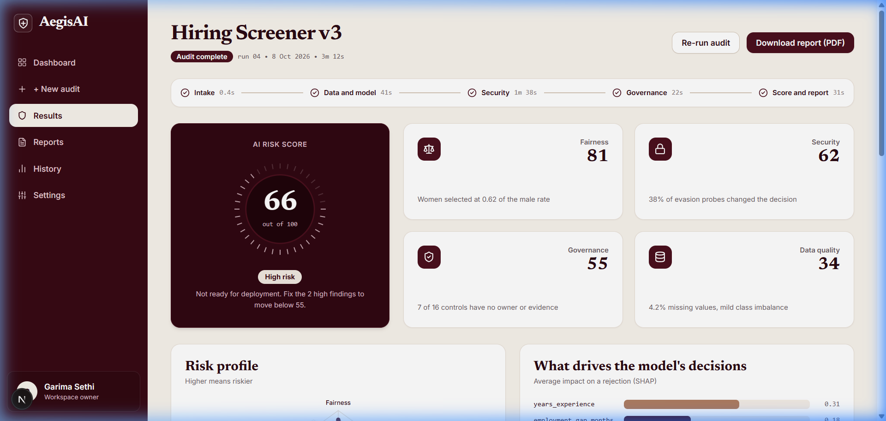
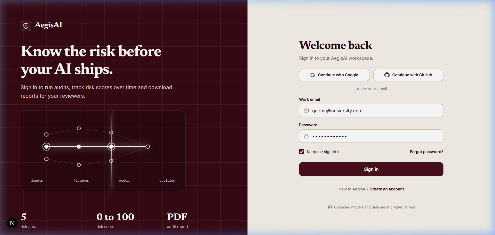
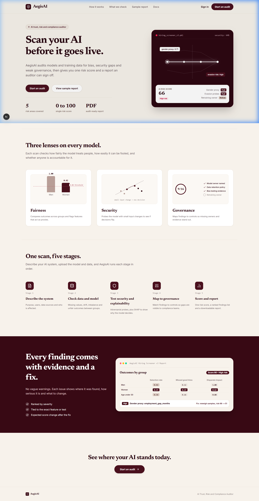

# Module M1: Intake & Registration – Documentation

> **Status:** Completed  
> **Module Lead:** Garima Sethi & Ankita Sharma  
> **Milestone:** M1 – Intake  

---

## 1. Purpose

Module M1 (Intake) serves as the primary entry point and registration gate for AegisAI. Before any AI system can be assessed for bias, security vulnerabilities, or governance non-compliance, it must be properly documented, categorized, and supplied with model artifacts, training datasets, and system documentation.

### Core Objectives
1. **System Cataloging & Inventory:** Register AI/ML systems with operational metadata, business purpose, domain context, sensitive attribute tags, and ownership.
2. **Dynamic Regulatory Risk Tier Classification:** Automatically calculate and suggest regulatory risk levels in accordance with the EU AI Act (Annex III High-Risk domains like employment, credit scoring, biometrics, critical infrastructure) and NIST AI RMF guidelines.
3. **Artifact Ingestion & Storage:** Handle file uploads (tabular datasets, pickled/ONNX/Joblib model binaries, model cards, and architecture specifications) with strict format validation, size caps, and cloud-swappable storage abstractions.
4. **Assessment Scoping:** Initialize audit assessments by configuring inspection domains across Module M2 (Data & Model Risk), Module M3 (Security & Explainability), and Module M4 (Governance Mapping).

---

## 2. Architecture & Data Flow

M1 coordinates the intake registration process through a 4-step wizard interface, Next.js App Router API route handlers, and persistence storage.



### Intake Wizard Stages
1. **Register System:** Name, description, intended use, operational purpose, and primary owner.
2. **Model Type & Risk Context:** Model classification (tabular classifier, regressor, LLM application, computer vision), domain context (hiring, lending, healthcare, marketing), sensitive demographic attributes, and suggested EU AI Act risk tier.
3. **Upload Artifacts:** Drag-and-drop file upload for dataset (`.csv`, `.parquet`, `.json`), model binary (`.pkl`, `.joblib`, `.onnx`), or documentation (`.pdf`, `.md`, `.docx`). LLM applications switch to system prompt & endpoint configuration.
4. **Review & Scope:** Scope checklist enabling Data Risk (M2), Security & Explainability (M3), and Governance (M4), followed by assessment initialization.

---

## 3. Data Model

The data model connects registered AI systems with repeatable audit runs (Assessments) and associated model/data files (Artifacts).



---

## 4. API Endpoints

All API endpoints are validated with Zod schemas and conform to the shared finding/system contracts.

| Method | Endpoint | Description | Status Code |
|---|---|---|---|
| `GET` | `/api/systems` | List registered systems (supports `search` & `riskTier` query params) | `200 OK` |
| `POST` | `/api/systems` | Register a new AI system and create its initial assessment draft | `201 Created` |
| `GET` | `/api/systems/:id` | Fetch system details, associated assessments, and artifacts | `200 OK` / `404 Not Found` |
| `POST` | `/api/systems/:id/assessments` | Create a new audit run assessment for an existing system | `201 Created` |
| `POST` | `/api/assessments/:id/artifacts` | Upload and link dataset, model, or documentation files | `201 Created` |
| `POST` | `/api/systems/suggest-risk` | Calculate suggested EU AI Act risk tier from domain & context | `200 OK` |

### Example cURL Commands

#### 1. Suggest Risk Tier
```bash
curl -X POST http://localhost:3000/api/systems/suggest-risk \
  -H "Content-Type: application/json" \
  -d '{
    "domainContext": "hiring",
    "modelType": "tabular_classifier",
    "sensitiveAttributes": ["gender", "age"]
  }'
```
**Response:**
```json
{
  "suggestedTier": "high",
  "rationale": "Under EU AI Act Annex III (Point 4), AI systems intended for recruitment, screening, ranking candidates, or making employment decisions are classified as High-Risk.",
  "relevantRules": ["EU AI Act Annex III (Point 4)"]
}
```

#### 2. Register an AI System
```bash
curl -X POST http://localhost:3000/api/systems \
  -H "Content-Type: application/json" \
  -d '{
    "name": "Hiring Screener v3",
    "description": "Automated resume parsing and candidate qualification ranking.",
    "purpose": "Screen inbound applicants to assist human recruiters in shortlisting.",
    "intendedUse": "First-round talent filtering for engineering roles.",
    "modelType": "tabular_classifier",
    "riskTier": "high",
    "domainContext": "hiring",
    "sensitiveAttributes": ["gender", "age", "race"],
    "owner": "People Operations AI Team"
  }'
```

---

## 5. How Logic & Checks Work

### 1. EU AI Act Annex III Risk Suggestion Engine
The backend helper (`web/lib/riskHelper.ts`) evaluates:
- **High-Risk Domains:**
  - `hiring` / `recruitment` &rarr; EU AI Act Annex III (Point 4): Employment, workers management and access to self-employment.
  - `credit_scoring` / `lending` &rarr; Annex III (Point 5b): Essential private and public services (creditworthiness).
  - `biometrics` / `facial_recognition` &rarr; Annex III (Point 1): Biometric identification and categorization.
  - `healthcare` / `medical_diagnosis` &rarr; High-risk safety component under Annex I/III.
- **Minimal / Low Risk Domains:**
  - `customer_service` / `chatbots` &rarr; Specific Transparency Risk (Title IV, Article 52): Requires disclosure that user is interacting with an AI system.
  - `marketing` / `recommendation` &rarr; Minimal Risk.
- Users may override the suggested tier with a mandatory justification.

### 2. Validation & Upload Caps
- **Datasets:** Maximum 100MB per file (`.csv`, `.parquet`, `.json`, `.jsonl`).
- **Models:** Maximum 250MB per file (`.joblib`, `.pkl`, `.onnx`, `.pt`, `.h5`, `.bin`).
- **Documentation:** Maximum 25MB per file (`.pdf`, `.md`, `.txt`, `.docx`).
- Form validations strictly enforced using Zod schemas (`web/lib/validations/system.ts`).

---

## 6. How to Run & Test

### Unit & Component Tests
```bash
cd web
npm test
```
Runs 27 Vitest tests covering:
- EU AI Act risk helper categorization logic.
- Zod schema validations for Step 1 through Step 4.
- Stepper, RiskTierBadge, and FileDropzone UI component rendering.
- Wizard form state management and draft persistence.

### Production Build Verification
```bash
cd web
npm run build
```
Ensures clean TypeScript compilation, Next.js App Router static prerendering (14/14 static pages), and zero lint errors.

### ML Service Health Test
```bash
cd ml-service
.\venv\Scripts\python -m pytest
```
Verifies FastAPI health endpoints and pydantic schema compatibility.

---

## 7. Screenshots

### 1. Main Dashboard


### 2. Hiring Screener v3 Audit Results


### 3. AegisAI Sign-in Screen


### 4. AegisAI Landing Page


---

## 8. Limitations & Future Work

1. **Storage Provider:** Local disk storage provider is utilized in the current local development setup. Production deployments should attach an S3/GCS bucket via `StorageProvider`.
2. **Asynchronous Large File Uploads:** Uploads currently use multi-part HTTP forms. Chunked parallel resumable uploads (via TUS protocol) are slated for future releases when multi-gigabyte models are submitted.
3. **Authentication Integrations:** OAuth2 / SAML single sign-on can be wired to university directory services in subsequent milestones.
